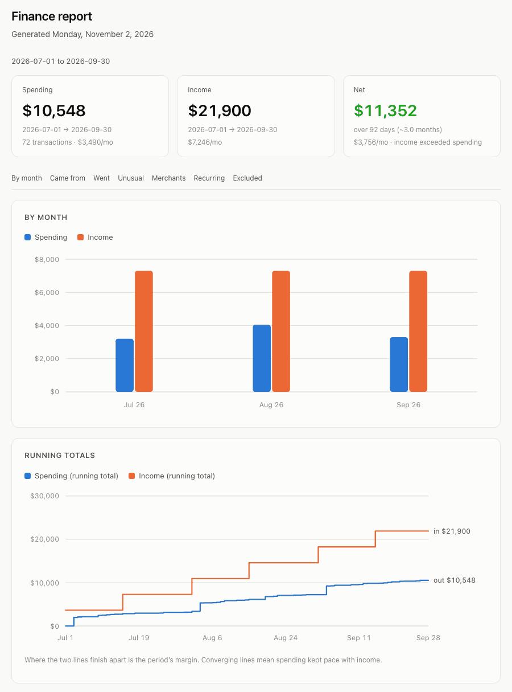
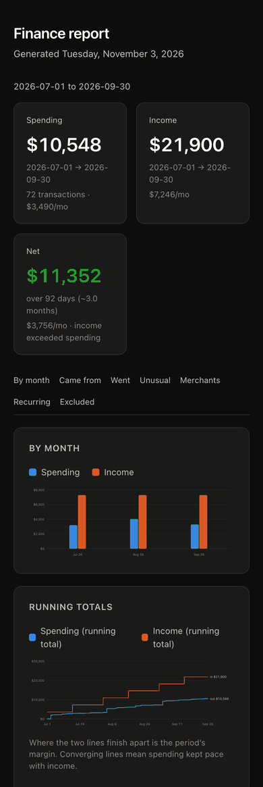
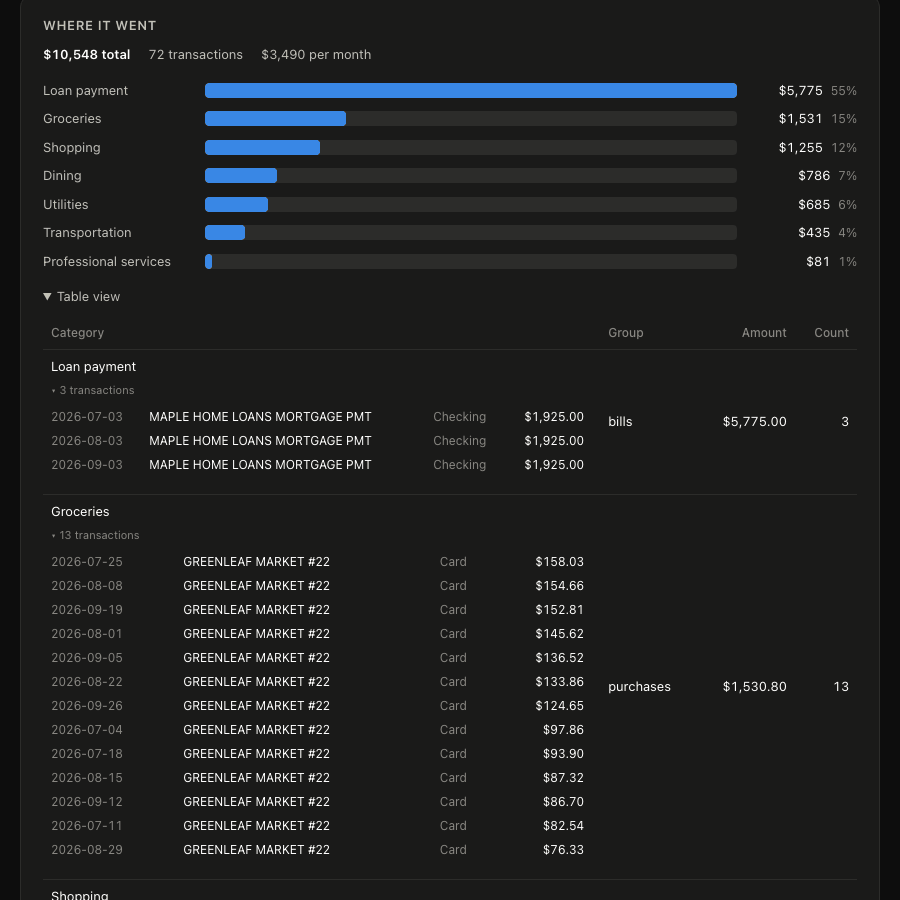
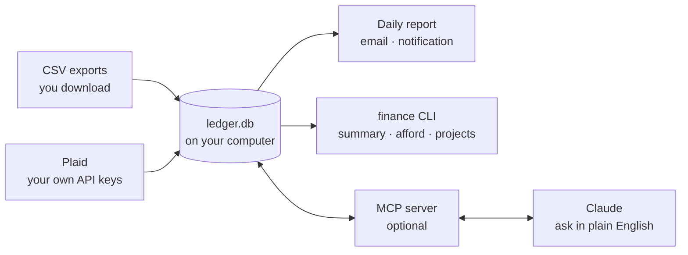

# local-finance-mcp

**Know exactly where your money goes — every account, every charge, in one place you own.**

Every morning a report can land in your inbox: what you spent and earned, which categories are
creeping up, the subscriptions quietly costing you hundreds a year, and the charges that don't look
right. When you're weighing something big — a car, a move, a remodel — it tells you what you can
actually afford, based on how you really spend. And you can ask Claude anything about it in plain
English.

No budgeting app in the middle and no monthly fee. Your transactions live in one file on your own
computer. Try it in about ten minutes with a CSV export from your bank, then link your banks through
Plaid so it stays up to date by itself.

<p align="center">
  
  &nbsp;
  
</p>
<p align="center">
  
</p>
<p align="center"><sub>Built from a made-up ledger. Every chart drills down to the transactions behind it.</sub></p>

## What it answers

- **Am I spending too much on food?** Every category and merchant, compared with the period before,
  and every bar opens to the transactions behind it.
- **What am I paying for every month?** Recurring charges with what each one costs per year, plus
  new merchants flagged the month they first appear, while a new subscription is cheapest to cancel.
- **Where did the big money go?** The largest charges, and anything unusual for its category, such
  as a duplicate charge or a grocery run three times the normal size.
- **How does this month compare?** Tabs for the last 30 days, month to date, the last 90 days and all time,
  each with income by payer and spending by month.
- **Can we afford it?** Your real median month gives a baseline and headroom. Try what-ifs for a car
  payment, a new mortgage or a bonus, including share vests that never reach a bank.
- **What did the remodel actually cost?** Budget, committed, and paid for any project, with costs
  flowing in from the transactions you tag.
- **Anything I should look at?** An optional AI read of the period: what changed, what is worth a
  look, and what is not worth cutting. Every figure in it is computed in code, never by the model.
- **And anything else.** Ask Claude in plain English: "what did the move cost us?", "which
  subscriptions went up this year?"

## Who it's for

Anyone who wants those answers from their own data **without a budgeting app in the middle** or a
subscription to pay. There is no account to create with us — there is no us. You need to be
comfortable typing a few commands in a terminal, because there is no app.

## How it works

1. **Bring in your accounts.** Start with a CSV export from each bank (free, no signup). For
   everyday use, link them through Plaid **using your own API keys**, so new transactions arrive by
   themselves. No server of ours sits in between.
2. **It builds a ledger on your computer.** Every transaction goes into one SQLite file,
   deduplicated and categorized, with card payments and transfers kept out of spending so nothing
   is counted twice.
3. **You use it.** Get a report by email or notification every morning, ask Claude questions, check
   what you can afford, and track budgets for projects like a remodel.



## Setup

| | |
|---|---|
| **About 10 minutes** to try it | Download an export from each bank and `finance setup` reads it. Every feature works this way, but the numbers only stay current if you keep downloading exports. |
| **About 15 more** to keep it current (recommended) | Create your own Plaid account and link each bank, and a daily report stays up to date by itself. Plaid can read the accounts you link, and real banks need its approval. [What that involves](docs/plaid.md). |
| **You need** | Node 20+ and a terminal. Optionally Claude or another MCP client, to ask questions. |
| **Runs on** | macOS, where it is built and used every day. Linux and Windows pass the same automated tests but have not had a real setup yet, so [reports](https://github.com/brandonmtaylor/local-finance-mcp/issues) are welcome. Desktop notifications and Mail.app are macOS-only; email by SMTP works everywhere. |

```bash
npm install -g local-finance-mcp
# or straight from GitHub: npm install -g github:brandonmtaylor/local-finance-mcp

finance setup           # reads a CSV export from your bank, and points you at Plaid if you want it
finance sync            # import your transactions
finance report --open   # build the report and open it
```

`finance setup` shows you three rows exactly as it would import them before writing anything.
`finance doctor` tells you what is missing at any point.

> ⚠️ **Add every account money moves through:** your checking accounts *and* every credit card you
> use. Anything you leave out is invisible. With checking but no cards, all you see is "paid the
> card", not what you bought. With cards but no checking, there's no income and no rent. `finance
> doctor` flags payments going to a card you haven't added. [Which accounts to link](docs/accounts.md).

Then, optionally:

- **Get it every morning:** `finance schedule install --daily 07:00`, then pick email or a
  notification. [Getting the report to you](docs/report.md#getting-the-report-to-you)
- **Ask Claude:** add the MCP server to your client. [Asking Claude](docs/mcp.md)

## Where to read more

| | |
|---|---|
| **[The report](docs/report.md)** | Every section explained, plus the optional AI analysis and the notes that brief it |
| **[Email and scheduling](docs/report.md#getting-the-report-to-you)** | Gmail or any SMTP account, a notification, a folder, or any command. Every report is also saved on your computer |
| **[Ask Claude](docs/mcp.md)** | Connect the MCP server. Claude can also fix a category or tag an episode, and tomorrow's report picks it up |
| **[What can I afford](docs/afford.md)** | How the baseline is built, every what-if, and share vests |
| **[Projects](docs/projects.md)** | Budgets, deposits you have committed to, and vendors |
| **Corrections and tags** | `finance categorize`, `finance tag`, `finance note`. A fix is permanent and survives every re-sync and re-link |
| **[CSV exports](docs/csv.md) · [Plaid](docs/plaid.md)** | Getting your data in, and what each way involves |
| **[Which accounts to link](docs/accounts.md)** | Why checking *and* cards, and joint accounts |
| **[Privacy and credentials](docs/privacy.md)** | Exactly what stays on your computer and what can leave it |
| **[How it works inside](docs/architecture.md)** | The pipeline, plus [design decisions](docs/decisions.md) and [writing a provider](docs/writing-a-provider.md) |

## Why you can trust the numbers

- **No double counting.** Card payments and transfers are excluded from spending; loan payments are
  counted. Re-linking a bank, overlapping exports, and two people linking one joint account don't
  duplicate anything.
- **Checks for wrong-but-plausible numbers.** `finance doctor` flags a card payment with no card
  behind it, data that has gone stale, and spending that is mostly uncategorized. A zero that means
  "no data" is never shown as "spent nothing".
- **Spending never goes negative.** A big refund lowers its category to zero, and the rest is
  reported separately.
- **The AI never does arithmetic.** Every figure is computed in code. The optional analysis is only
  allowed to quote them.

> **Not financial advice.** This computes numbers from what your bank exports, and works hard to get
> them right, but check anything you act on against your statements.

## Privacy, in short

- **Your ledger never leaves your computer.** The CLI and the report need no network and no AI.
- **API keys and passwords go in your OS keystore**, never in a config file, and no tool returns
  them.
- **Leaving your computer is always your choice:** what you show Claude through MCP, the optional AI
  analysis, and the sync itself, which fetches from your bank or Plaid.
- **One weak spot, stated plainly:** if you use Plaid, the per-bank access tokens are stored by the
  Plaid CLI in a file only your user can read, but not encrypted. CSV needs no tokens at all.

The full account is in [Privacy and credentials](docs/privacy.md).

## Every command

| | |
|---|---|
| `init` · `setup` · `doctor` | get started, and find out what is missing |
| `link` · `sync` · `backfill` | connect accounts and pull data |
| `connections` | list, disable, enable, probe a connection |
| `accounts` · `summary` · `insights` · `report` · `run` | what is linked, and what happened |
| `afford` | what you can take on |
| `project` · `notes` | plan, and brief the analysis |
| `transfers` | split brokerage transfers by the sub-account behind them |
| `query` · `categorize` · `note` · `tag` | correct and interrogate |
| `secret` · `schedule` · `prune` · `mcp` | plumbing |

`finance <command> --help` for any of them.

## Development

```bash
npm install
npm test
npm run build
npm run typecheck
```

## Security

Report vulnerabilities privately — see [SECURITY.md](SECURITY.md).

## License

MIT
