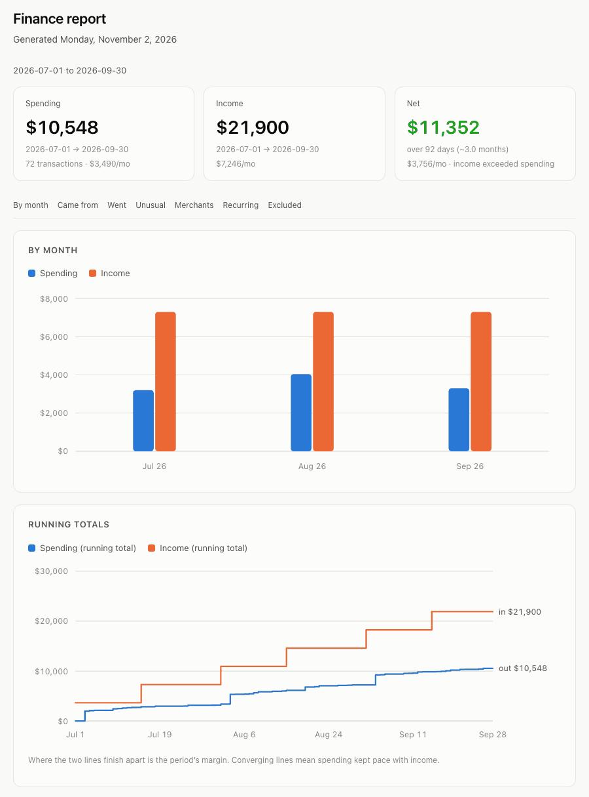
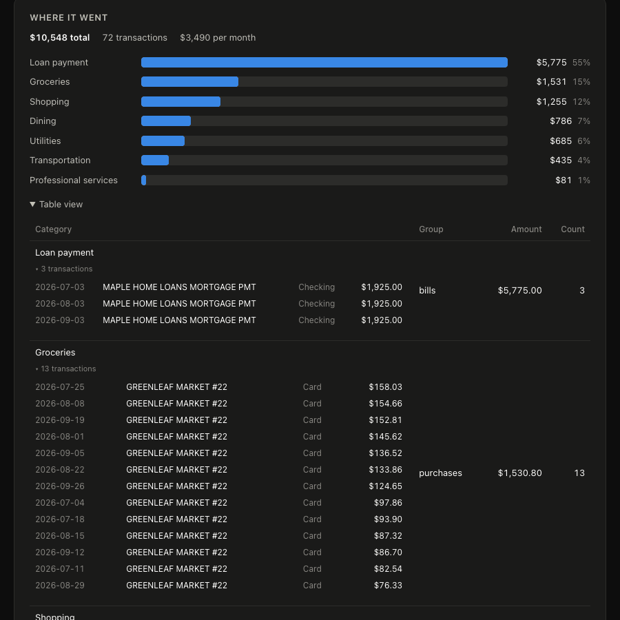
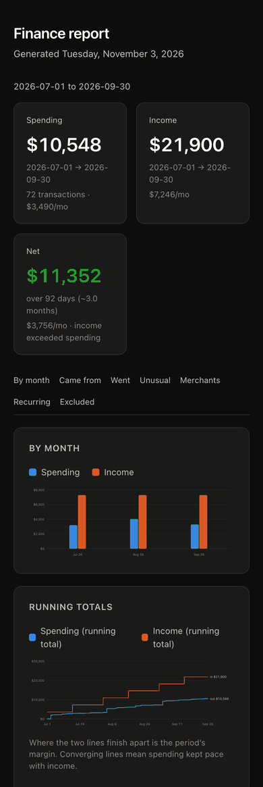

# The report

```bash
finance report                    # writes an HTML file
finance report --open             # and opens it in your browser
finance report --range last-90-days
finance run                       # sync, report, deliver — what the scheduler calls
```

One self-contained HTML file. **No scripts, no external requests, no fonts, nothing fetched.** It
opens offline, in a mail client, on a plane, and in five years. That constraint is why the
interactive parts are built on `<details>` and CSS rather than JavaScript — a mail client will not
run a script, and a drill-down built on one would be dead exactly where the report is most often
read.



What is in it:

| | |
|---|---|
| **By month / Running totals** | inline SVG, four date ranges behind CSS-only tabs |
| **Where it came from** | income by payer, with the median gap between payments — which is what shows a payer that quietly stopped |
| **Where it went** | categories and merchants, each expanding to the transactions behind it |
| **What changed** | category deltas against the preceding period, suppressed entirely when the ledger does not cover it |
| **Unusual for their category** | measured against the median in the *same* category, since a big grocery run and a big mortgage payment are not comparably surprising. Where a duplicate charge shows up first |
| **First seen this period** | merchants with no prior history — a new recurring charge is cheapest to cancel while it is new. Left out until the ledger reaches back past the period, when everything would qualify |
| **Recurring** | with cost per year, which is the number that decides anything: $40 waves through and $1,040 a year does not, and they are the same charge |
| **Where you stand** | balances, with cash, investments and debt kept apart — brokerage holdings are not spendable money |
| **Not counted as spending** | transfers and card payments, and why |



## The AI section

Optional and off by default. It runs a **command**, not an API — so no key lives here:

```toml
[report]
ai = true          # must be under [report], NOT under [report.smtp]

[narration]
enabled = true
command = "claude"
args = ["-p"]
```

`claude -p` uses an existing login. `ollama run <model>` keeps it entirely on your machine. Anything
that reads stdin and writes markdown works.

It is told to use only figures from the brief and never to compute one, because a wrong number in a
finance report is worse than no analysis. Savings figures — cost per year, and what stopping
something would save — are computed in code and handed over for exactly that reason. It is also told
that recurring is not the same as wasteful, and to say plainly when nothing is worth cutting rather
than inventing a suggestion.

The analysis reads **at least 90 days** regardless of the range on display: recurring detection needs
a charge to appear more than once, and over 30 days a monthly subscription appears exactly once and
is invisible.

### Notes for the analysis

The AI analysis sees aggregates and flagged transactions. It has no way to know that a large
recurring transfer is your mortgage, that one subscription is a business expense, or that you are
saving for a deposit and every suggestion should be read against that. Without that it states the
obvious and misreads the deliberate — a savings plan looks like a spending problem.

```bash
finance notes          # creates the file and tells you what helps
finance notes --show   # exactly what is being sent
```

It is plain markdown, read on every report. Worth writing down: what a large recurring payment
actually **is**, what is deliberate so it stops being flagged as an anomaly, what you are saving for,
and what **not** to suggest cutting.

The notes sit before the rules in the prompt, not after: they may add context, they may not loosen
the constraint that every figure comes from your data.

## Getting the report to you

**Every report is saved on your computer first**, in `reports/` under the data directory. On macOS
that is `~/Library/Application Support/finance-mcp/reports/report-<start>_<end>.html`. Reports are
kept until you delete them, and a failed delivery never costs you one. `finance report --out <path>`
writes it somewhere else instead, and `--open` opens the one it just wrote in a browser.

`deliver` in `[report]` picks how you hear about it. List as many channels as you like:

```toml
[report]
deliver = ["notify", "smtp"]
```

| Channel | What it does | Needs |
|---|---|---|
| `notify` | A macOS notification with spending, income and net in it | Nothing |
| `smtp` | **Emails it to you.** Best way to read it on a phone | An app password |
| `email` | Emails it through Mail.app | macOS, Mail.app set up |
| `copy` | Copies the file into another folder, such as Dropbox | A folder |
| `command` | Hands the file to any program — ntfy, Telegram, a script | The program |
| `open` | Opens it in your browser | Being at the computer |
| `save-only` | Only saves it | Nothing |



### Email

The email has the three figures in the body, with any warnings above them, so the subject line and
preview are often all you need to read. The full report is attached as one HTML file, which a phone
opens with a tap — no app, nothing loaded from the network. It is laid out for a phone screen.

**There are two ways to send it.**

**1. `smtp` — recommended.** It sends the message itself through your mail provider, so it works
the same from a scheduled job as from a terminal. For Gmail:

1. Turn on 2-Step Verification, then create an **app password** at
   <https://myaccount.google.com/apppasswords>. Gmail rejects your normal password here.
2. Store it in the OS keystore, not the config file:
   ```bash
   finance secret set smtp password
   ```
3. Add the account to `config.toml` and add `"smtp"` to `deliver`:
   ```toml
   [report.smtp]
   host = "smtp.gmail.com"
   port = 587                 # 587 = STARTTLS, 465 = implicit TLS
   user = "you@gmail.com"     # the account that sends it
   to = "you@gmail.com"       # where it goes; can be a different address
   ```
4. Run `finance run` once by hand to check it arrives.

You may prefer to send from a separate Gmail account kept for the job, so the app password cannot
reach your main inbox.

**2. `email` — Mail.app, macOS only.** No password is stored anywhere, because it uses the Mail
account you already have. Set `emailTo = "you@example.com"` under `[report]`. Set
`sendEmail = false` to get a draft to review instead of a sent message. It has two drawbacks for a
daily job. Driving Mail **opens Mail.app** on your desktop every morning. And the first run needs
you to allow the terminal under System Settings → Privacy & Security → Automation. Mail also
sometimes fails to answer in time (error -1712). Use it if you want the reports in your Mail
sent items, and `smtp` otherwise.

<br clear="right">

## Scheduling

```bash
finance schedule install --daily 07:00
finance schedule status
finance schedule uninstall
```

The job runs `finance run`: sync, build the report, deliver it. The range, channels and AI setting
come from `[report]` in the config, so edit that and re-run the install — there are no flags to
remember.

On macOS this generates a **LaunchAgent** — not a LaunchDaemon, because an Agent runs inside your
logged-in session and can therefore reach the login keychain. The generated job uses an absolute
path to `node`, since launchd doesn't inherit your shell `PATH`.
